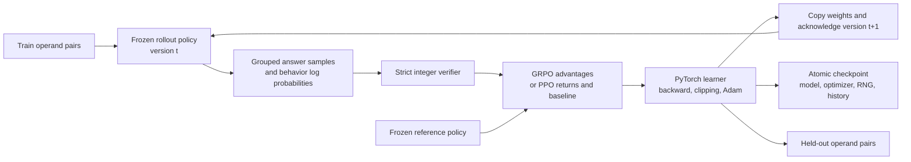
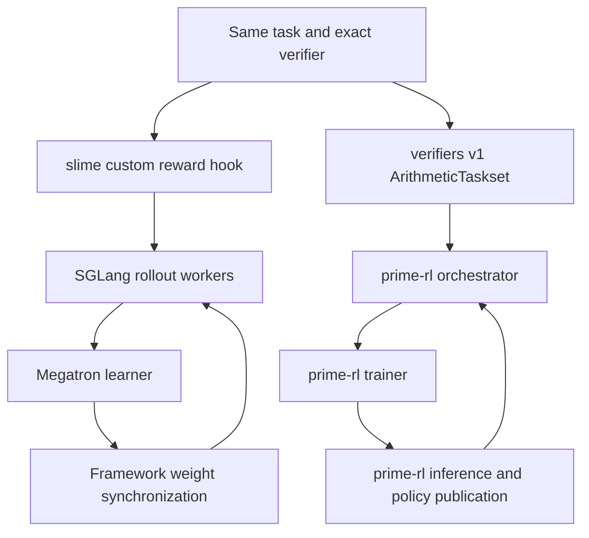

# rltune

Learn post-training by building a small system you can inspect, break, and recover. Then carry the same task into slime and Prime Intellect's training stack.

This repository starts with real **Python and PyTorch** training on a CPU: **SFT, DPO, GRPO, and PPO**. It adds a strict reward verifier, independent rollout-policy snapshots, policy-version checks, bounded asynchronous collection, atomic checkpoints, optimizer/RNG recovery, and held-out evaluation. The external track provides a **verifiers v1 taskset**, a **prime-rl recipe**, and a **slime custom reward hook**.

The local policy is a small neural network answering addition questions with one categorical action. It is a teaching model, not an LLM. slime/Megatron/SGLang and prime-rl GPU training remain a separate practical milestone. No distributed training result is claimed here.

## Start on your Mac or a Linux CPU

Requires Python 3.11+ and [uv](https://docs.astral.sh/uv/). No model downloads, API keys, or paid services are needed for the local lab.

```bash
git clone https://github.com/abhijithneilabraham/rltune.git
cd rltune
uv sync --extra dev --locked
uv run rltune sft --steps 200 --output runs/sft
uv run rltune dpo --steps 200 --output runs/dpo
uv run rltune grpo --steps 200 --output runs/grpo
uv run rltune ppo --steps 200 --output runs/ppo
uv run python -m rltune.rollout_demo
uv run pytest -q
# Reproduce the table below into a fresh directory:
uv run python scripts/compare_methods.py --output runs/comparison
```

Each training run writes `checkpoint.pt` and `metrics.json`. Use a new output directory for another experiment. `--steps` is the total desired step count:

```bash
uv run rltune grpo --steps 300 --output runs/grpo --resume
```

Resume restores the model, frozen reference policy, Adam state, torch RNG, configuration, step number, and metric history. A second writer to the same directory is refused. The suite verifies that interrupted/resumed training matches an uninterrupted run, including every model tensor, for all four methods. Checkpoints use PyTorch's restricted `weights_only=True` loader.

## Evaluate a serving model

With a trusted SGLang or other OpenAI-compatible server already running:

```bash
uv run python -m rltune.eval_server --base-url http://localhost:30000/v1/ \
  --model YOUR_SERVED_MODEL --concurrency 4 --output runs/server-eval.json
```

This makes 20 held-out requests and writes responses, verifier outcomes and failure counts. HTTP/schema failures are counted separately from wrong answers; accuracy is reported on completed requests alongside coverage. Credentials are read from `OPENAI_API_KEY` if set. There are no automatic retries or server launches. This is evaluation, not remote policy training or proof of synchronized weights. The client is tested against a controlled HTTP transport; an actual SGLang endpoint has not been exercised here.

## What to learn, in order

| Lab | Build and inspect | Completion evidence |
|---|---|---|
| [1. Task and verifier](docs/labs.md#1-task-and-verifier) | Exact integer grading; malformed and adversarial answers; separate train/eval pairs | Explain what the verifier proves and three things it cannot prove |
| [2. SFT](docs/labs.md#2-sft) | Cross-entropy, logits, autograd, Adam, held-out accuracy | Run 200 steps and explain loss versus accuracy |
| [3. DPO](docs/labs.md#3-dpo) | Chosen/rejected pairs, frozen reference, preference margin | Show the gradient favors the chosen action |
| [4. GRPO](docs/labs.md#4-grpo) | Group sampling, reward normalization, clipping, reference KL | Explain an all-zero advantage group and inspect policy updates |
| [5. PPO](docs/labs.md#5-ppo) | Learned value baseline and critic loss | Compare critic predictions to rewards and explain one-step returns |
| [6. Harness operations](docs/labs.md#6-harness-operations) | Versions, timeouts, retries, checkpoints, failure drills | Recover a run and reject stale rollouts |
| [7. External frameworks](docs/upstream-stacks.md) | verifiers taskset, prime-rl, slime + Megatron + SGLang | Collect actual GPU logs, policy-sync evidence, and restart evidence |

Read the [objective walkthrough](docs/objectives.md) alongside the code. Use the [operations runbook](docs/operations.md) when something goes wrong. Record your own runs in the [experiment template](docs/experiment-template.md).

## Architecture



SFT and DPO use offline labels/preferences and bypass rollout sampling. `operations.collect` is a separate async collector exercise tested with deliberate failures. The local trainer collects tensor batches synchronously; it does not claim network-distributed rollout orchestration.



The first diagram runs locally. The second is the intended framework integration path; a locally constructed taskset is not evidence that the distributed GPU path has run.

## Initial measured learning runs

Recorded on macOS arm64, Python 3.12.3, PyTorch 2.15.0, CPU, seed 7, 200 steps per method, default config. Evaluation uses only 20 held-out operand pairs. These are single-seed teaching checks, not a method ranking or evidence of general mathematical reasoning.

| Method | Initial held-out accuracy | Final held-out accuracy |
|---|---:|---:|
| SFT | 10% | 90% |
| DPO | 10% | 45% |
| GRPO | 10% | 65% |
| PPO | 10% | 35% |

[Recorded metrics and environment](docs/local-results.json). Rewards are exact-match training outcomes; evaluation is greedy accuracy on separate operand pairs. SFT/DPO have no sampled rollout reward, so that metric is `null`. Re-run with seeds 11 and 19 before drawing any conclusion. Some held-out pairs reverse operands present during training; this is a small within-range generalization check, not an out-of-distribution benchmark.

## Current status

- Implemented and locally tested: four objectives, real optimizer updates, strict verifier, CPU eval, local policy copying, stale-version guard, async fault drill, atomic checkpoint and exact restart.
- Implemented: slime reward adapter and verifiers taskset/prime-rl configuration, tied to source revisions in [upstream.lock.json](upstream.lock.json). See the integration guide for exact validation status.
- Still to do on NVIDIA hardware: run both framework trainers; inspect actual GPU rollout/weight sync; exercise optimizer recovery across ranks; run an extended soak; evaluate a trained language-model checkpoint.

See [validation details](docs/validation.md) for commands, results and remaining checks.

Local copy-based synchronization teaches ownership and versioning. It does not establish NCCL transport, TP/PP/FSDP training, checkpoint conversion, or multi-node failure recovery. Those are explicit exercises in the external track.

## Repository map

```text
src/rltune/task.py          task, split, strict verifier
src/rltune/losses.py        inspectable objective functions
src/rltune/training.py      policy, reference, rollouts, updates, resume
src/rltune/operations.py    concurrency, policy versions, atomic saves
src/rltune/rollout_demo.py  runnable timeout/disconnect drill
src/rltune/eval_server.py   optional real serving-endpoint evaluation
integrations/slime/        reward hook and JSONL exporter
integrations/prime/        installable verifiers taskset and RL config
scripts/prepare_upstreams.py  fetch source revisions without launching jobs
tests/                     behavior, gradient, learning and recovery checks
docs/                      curriculum, math, operations and experiment record
```

CI runs CPU tests and Ruff on Linux. The optional verifiers test requires the separately installed integration; default CI does not validate GPU stacks. MIT licensed.
